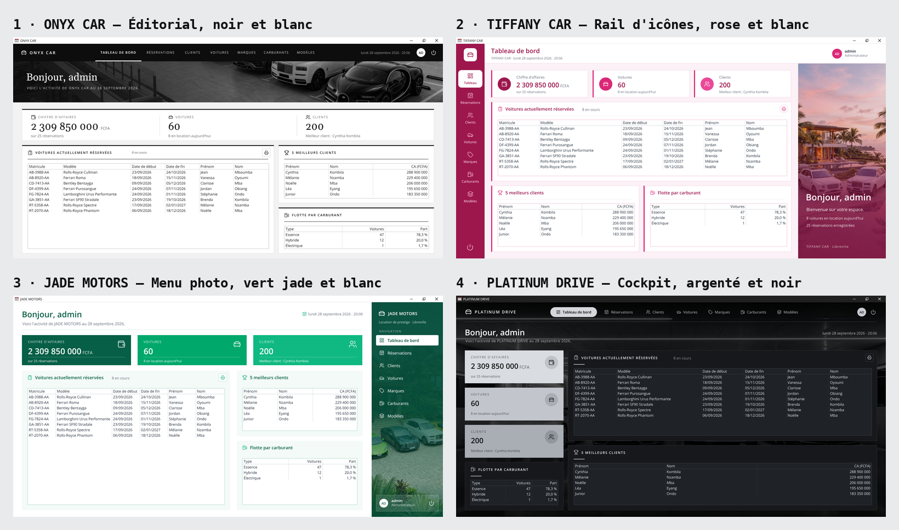
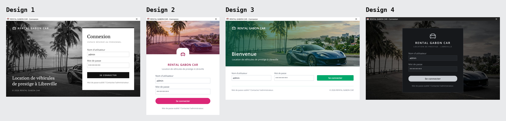

# Les 4 projets « camarades »

Quatre maquettes **réellement différentes**, une par camarade. Chacune a sa navigation, sa disposition, ses cartes,
son écran de connexion et sa façon d'utiliser les photos, en plus de sa palette de couleurs. Les données (parc haut de
gamme) et le mode d'emploi général (`../README.md`) restent communs.

| | Entreprise | Design | Couleurs | Dossier | Télécharger |
|---|---|---|---|---|---|
| 1 | **ONYX CAR** | Éditorial | Noir et blanc | [`noir-blanc/`](noir-blanc/) | [ONYX-CAR-noir-blanc.zip](https://github.com/juliusnovalis-boop/ki/raw/arena/01a0e965-ki/projets/ONYX-CAR-noir-blanc.zip) |
| 2 | **TIFFANY CAR** | Rail d'icônes | Rose et blanc | [`rose-blanc/`](rose-blanc/) | [TIFFANY-CAR-rose-blanc.zip](https://github.com/juliusnovalis-boop/ki/raw/arena/01a0e965-ki/projets/TIFFANY-CAR-rose-blanc.zip) |
| 3 | **JADE MOTORS** | Menu photo à droite | Vert jade et blanc | [`vert-jade-blanc/`](vert-jade-blanc/) | [JADE-MOTORS-vert-jade-blanc.zip](https://github.com/juliusnovalis-boop/ki/raw/arena/01a0e965-ki/projets/JADE-MOTORS-vert-jade-blanc.zip) |
| 4 | **PLATINUM DRIVE** | Cockpit | Argenté et noir | [`argente-noir/`](argente-noir/) | [PLATINUM-DRIVE-argente-noir.zip](https://github.com/juliusnovalis-boop/ki/raw/arena/01a0e965-ki/projets/PLATINUM-DRIVE-argente-noir.zip) |

## Maquette spéciale · bleu royal et noir

| | Entreprise | Design | Couleurs | Dossier | Télécharger |
|---|---|---|---|---|---|
| ★ | **RENTAL GABON CAR** | Prestige | Bleu royal et noir, or, argent, blanc | [`bleu-royal-noir/`](bleu-royal-noir/) | [RENTAL-GABON-CAR-bleu-royal-noir.zip](https://github.com/juliusnovalis-boop/ki/raw/arena/01a0e965-ki/projets/RENTAL-GABON-CAR-bleu-royal-noir.zip) |

Barre noire avec onglets en pastilles centrés (comme argenté-noir), filet doré, bandeau photo sur chaque page, 4 indicateurs, graphique de la flotte, recherche dans les listes, fiches en colonne à droite, connexion en deux panneaux. Mode d'emploi : [`bleu-royal-noir/LISEZMOI.md`](bleu-royal-noir/LISEZMOI.md).

Chaque projet a **son zip** (dossier `projets/` à la racine du dépôt) qui contient : `LISEZMOI.md` (mode d'emploi du design),
`couleur.md` (toutes les couleurs à saisir dans Access), `COTES.md` (positions et tailles en cm), `png/` (les 8 écrans),
`ICONES.md` et `apercu-icones.png` (liste et aperçu de **toutes** les icônes), `assets/` (icônes en PNG) et `assets/photos/` (photos de voitures **propres à ce projet**, déjà recadrées).
Les zips sont produits par `python3 outils/projets.py`, après `outils/generer.py`.

## Ce qui distingue les 4 designs

| | 1. ONYX CAR · Éditorial | 2. TIFFANY CAR · Rail d'icônes | 3. JADE MOTORS · Menu photo à droite | 4. PLATINUM DRIVE · Cockpit |
|---|---|---|---|---|
| Navigation | Barre noire **en haut**, libellés en majuscules soulignés | **Rail étroit à gauche** : icône + petit libellé | **Menu à droite** sur une photo, carte utilisateur en bas | **Pastilles** centrées en haut, sur la photo |
| En-tête | Intégré à la barre de navigation | Titre de page + date, avatar à droite | Aucun : titre directement dans la page | Titre blanc posé sur la photo |
| Photos | Grand **bandeau** noir et blanc sur toute la largeur | **Panneau vertical** à droite avec un grand chiffre | Photo **du menu**, différente sur chaque page | Photo **plein écran** derrière toute l'application |
| Indicateurs | Une seule bande, chiffres en Georgia séparés par des traits | 3 cartes blanches avec pastille ronde | 3 blocs pleins, icône en haut à droite | 3 blocs argentés **empilés** à gauche |
| Cartes | Filet noir épais en haut, titres en majuscules espacées | Barre rose à gauche | Fond vert très clair, sans bordure | Fond anthracite, petit trait argenté sous le titre |
| Fiches (clients…) | **Liste à gauche**, fiche à droite | **Fiche en haut** sur 2 colonnes, liste dessous | Fiche à gauche, **libellés au-dessus** des champs | **Liste en haut**, fiche dessous sur 3 colonnes |
| Réservations | Client, voiture et montant en 3 cartes, puis une ligne réservation | Réservation en haut, montant sur la photo | 3 cartes côte à côte, libellés au-dessus | Colonne réservation + montant à gauche |
| Boutons | Carrés, texte en majuscules | Arrondis (pilule) | Rectangles classiques | Arrondis argentés |
| Connexion | Photo plein cadre, carte blanche à droite | Fenêtre verticale, photo en haut, logo rond | Photo en haut, champs **sur une ligne** | Photo sombre, carte centrée |

## Réaliser chaque design dans Access

### 1. ONYX CAR · Éditorial (noir et blanc)
* Formulaire de navigation, disposition **« Onglets horizontaux »**. Barre : Rectangle `#0D0D0D` de 1,69 cm de haut.
  Boutons de navigation : fond `#0D0D0D`, texte `#D4D4D4` en Segoe UI 9 pt **majuscules**, sans bordure ;
  onglet actif : texte blanc gras et un trait blanc de 3 pt dessous (petit rectangle blanc).
* Bandeau : contrôle Image `a-bandeau-<page>.jpg` (41,49 × 3,97 cm) en haut du sous-formulaire.
  Titre en **Georgia** 28 pt blanc, sous-titre en majuscules 9 pt `#D4D4D4`.
* Cartes : Rectangle blanc, bordure `#E0E0E0`, et un rectangle noir de 0,08 cm collé en haut (le filet).
  Titres en majuscules 9 pt, gras.
* Les grands chiffres (indicateurs, montant) sont en Georgia 28 pt.

### 2. TIFFANY CAR · Rail d'icônes (rose et blanc)
* Formulaire de navigation **« Onglets verticaux, à gauche »**, réduit à 2,75 cm de large. Boutons de navigation :
  `Disposition image légende` **Haut** (icône au-dessus du texte), Segoe UI 9 pt, `Forme` **Rectangle arrondi** ;
  onglet actif : fond blanc, texte `#9D174D`.
* Panneau photo : contrôle Image `b-panneau-<page>.jpg` (8,47 × 18,84 cm) collé à droite. Par-dessus, une zone de
  texte transparente pour le grand chiffre (40 pt blanc), par exemple `=CpteDom("*";"Client")`.
* Cartes : Rectangle blanc, bordure `#F2D2E1`, et un rectangle `#DB2777` de 0,11 cm sur le bord gauche.
* Boutons : `Forme` **Rectangle arrondi** (Enregistrer, Supprimer, Se connecter) ou **Ovale** (petits boutons).
* Connexion : formulaire de 12,70 × 16,40 cm (vertical).

### 3. JADE MOTORS · Menu photo à droite (vert jade et blanc)
* Formulaire de navigation **« Onglets verticaux, à droite »** (6,88 cm). Derrière les boutons, l'image
  `c-menu-<page>.jpg` (6,88 × 20,74 cm). Boutons de navigation : `Style fond` **Transparent**, texte blanc ;
  onglet actif : fond blanc, texte `#064E3B`.
* Pas d'en-tête : le titre (22 pt `#065F46`) et le sous-titre sont dans chaque sous-formulaire.
* Champs : étiquette **au-dessus** de la zone de texte (étiquette 9,5 pt, puis le champ 0,53 cm plus bas).
* Cartes : Rectangle `#F3FAF7` sans bordure.

### 4. PLATINUM DRIVE · Cockpit (argenté et noir)
* Formulaire de navigation **« Onglets horizontaux »**. Propriété **`Image`** du formulaire Menu :
  `d-fond-<page>.jpg` (41,49 × 20,74 cm), `Mode affichage image` **Découpage**. Dans chaque sous-formulaire,
  `Style fond` des sections : **Transparent**, ou la même image en fond.
* Boutons de navigation : `Forme` **Rectangle arrondi** (pastille), `Style fond` Transparent, texte `#B8BCC2` ;
  onglet actif : fond `#D4D7DB`, texte noir.
* Cartes : Rectangle `#16181B`, bordure `#2A2D32`, titres en majuscules 9,5 pt `#E8EAED`, petit trait `#C9CDD2`
  de 1,06 cm sous le titre. Zones de texte : fond `#1F2226`, texte `#F1F2F4`, bordure `#3A3E44`.
* Indicateurs et montant : Rectangle argenté (`#D9DCE0`, `#C2C6CC`, `#A9AEB5`), texte et icônes noirs.
* La barre de titre sombre correspond au mode sombre de Windows : elle ne se règle pas dans Access.

## Couleurs à saisir dans Access

| Élément | 1. Noir et blanc | 2. Rose et blanc | 3. Vert jade et blanc | 4. Argenté et noir |
|---|---|---|---|---|
| Menu / barre de navigation (fond) | `#0D0D0D` | `#9D174D` | `#064E3B` | `#000000` |
| Fond de la zone de contenu | `#F2F2F2` | `#FCF1F6` | `#EDF7F3` | `#0B0C0E` |
| Cartes (fond) | `#FFFFFF` | `#FFFFFF` | `#FFFFFF` | `#16181B` |
| Bordure des cartes | `#DADADA` | `#F2D2E1` | `#CDE7DC` | `#2A2D32` |
| Titres | `#0D0D0D` | `#9D174D` | `#065F46` | `#E8EAED` |
| Bouton principal, avatar | `#111111` | `#DB2777` | `#00A86B` | `#C9CDD2` |
| Texte du bouton principal | `#FFFFFF` | `#FFFFFF` | `#FFFFFF` | `#0B0C0E` |
| Texte du menu | `#D4D4D4` | `#FCE1EE` | `#D1F2E4` | `#B8BCC2` |
| Onglet actif (fond) | `#FFFFFF` | `#FFFFFF` | `#FFFFFF` | `#D4D7DB` |
| Onglet actif (texte) | `#0D0D0D` | `#9D174D` | `#064E3B` | `#000000` |
| Zones de texte (fond) | `#FFFFFF` | `#FFFFFF` | `#FFFFFF` | `#1F2226` |
| Zones de texte (bordure) | `#C8C8C8` | `#C9D0DA` | `#C9D0DA` | `#3A3E44` |
| Texte des champs | `#111111` | `#111827` | `#111827` | `#F1F2F4` |
| Étiquettes | `#4A4A4A` | `#4B5563` | `#4B5563` | `#A3A8AF` |
| Champ en lecture seule (fond) | `#F5F5F5` | `#FAF5F7` | `#F4F8F6` | `#1A1C20` |
| Montant (fond) | `#F1F1F1` | `#FDE8F2` | `#E2F5EC` | `#24272C` |
| Montant (texte) | `#0D0D0D` | `#9D174D` | `#047857` | `#F1F2F4` |
| Zones de liste (bordure) | `#BDBDBD` | `#EBB8CF` | `#A8D6C2` | `#3A3E44` |
| Supprimer (texte) | `#DC2626` | `#B91C1C` | `#DC2626` | `#F87171` |
| Indicateurs (fond 1 / 2 / 3) | `#0D0D0D` / `#262626` / `#404040` | `#9D174D` / `#DB2777` / `#EC4899` | `#065F46` / `#00A86B` / `#10B981` | `#D9DCE0` / `#C2C6CC` / `#A9AEB5` |

Pour régénérer un seul design : `python3 outils/generer.py rose-blanc` (voir `../README.md`).
